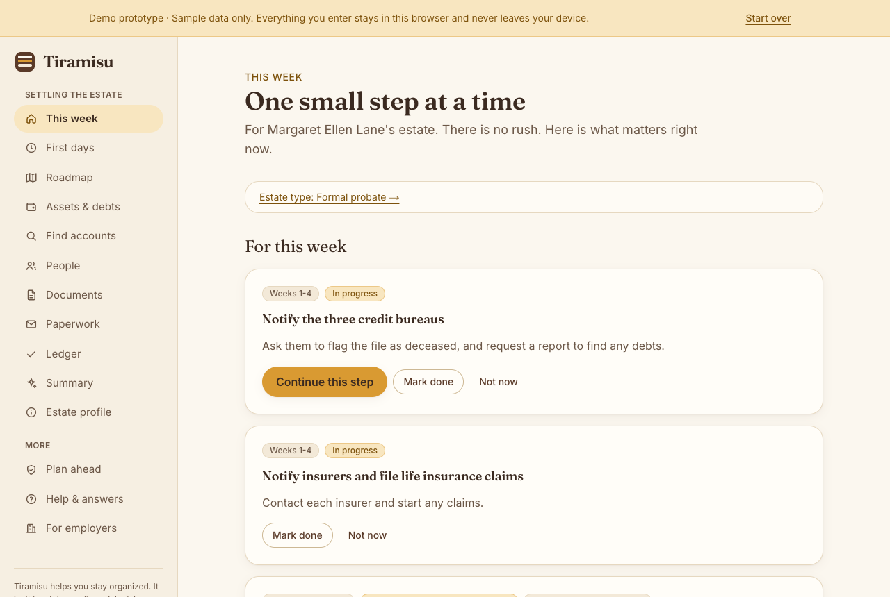
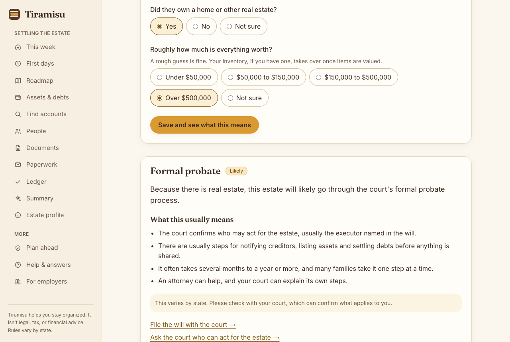
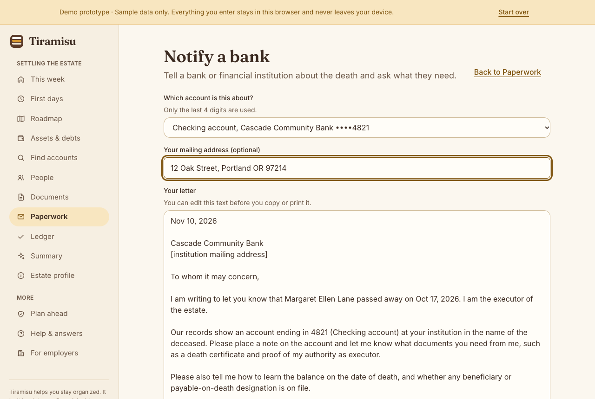

# Tiramisu: a calm, step-by-step guide for families settling a loved one's estate

**▶ [Open the live demo](https://anhlam09.github.io/tiramisu/)**, then click **Explore a sample estate**. It takes about 2 minutes and uses made-up data.

**📄 [Read the case study](CASE_STUDY.md)**: the problem, the design decisions, and what's simulated.

| | |
|---|---|
| **Who it's for** | The family member sorting out everything a loved one owned and owed after they die (their estate), usually called the executor |
| **The problem** | About 50 tasks with courts, banks, insurers and the IRS, often over 6–18 months, while grieving |
| **What it does** | Turns that into a weekly plan, organizes accounts and paperwork, and keeps sensitive numbers private |
| **What's real** | ✅ **Working:** the weekly plan and roadmap, estate-type questions, assets and debts with who inherits, the ledger, letters and worksheets, people and requests, Plan ahead, privacy masking 🧪 **Simulated, and labeled in the app:** document reading, account search, the employer view, and sharing ⛔ **Not built:** real document reading, filing or sending anything, real asset search, accounts, and state-specific rules |

| This week | What kind of estate is this? | A letter, filled in |
|---|---|---|
|  |  |  |

Everything you enter in the demo stays in your own browser and is never sent anywhere.

**Tried it?** Share what was clear and what wasn't through the [feedback form](https://github.com/Anhlam09/tiramisu/issues/new?template=usability-feedback.yml).

---

This repository contains only the published demo website. The source code is private.

### Disclaimer

Tiramisu is a free, non-commercial, experimental project created for educational purposes and personal exploration.

The project was inspired by existing ideas in the estate-settlement space and was independently developed with AI-assisted coding tools. It is not affiliated with, sponsored by, or endorsed by any estate-planning company.

Tiramisu is a functional prototype, not a production-ready service. Some features, including document extraction, are simulated.

The information provided is for demonstration purposes only and does not constitute legal, tax, or financial advice. Do not use this prototype to manage real estates or upload sensitive personal information.

All names and examples in the demo are fictional.

### Copyright

© 2026. All rights reserved. See [LICENSE](LICENSE). No part of this project may be copied or reused without written permission.
